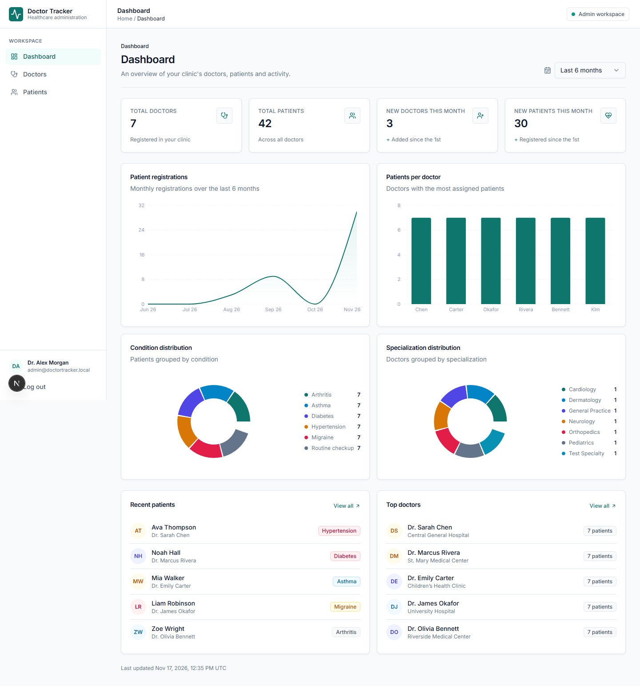
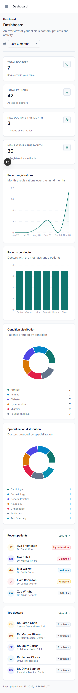
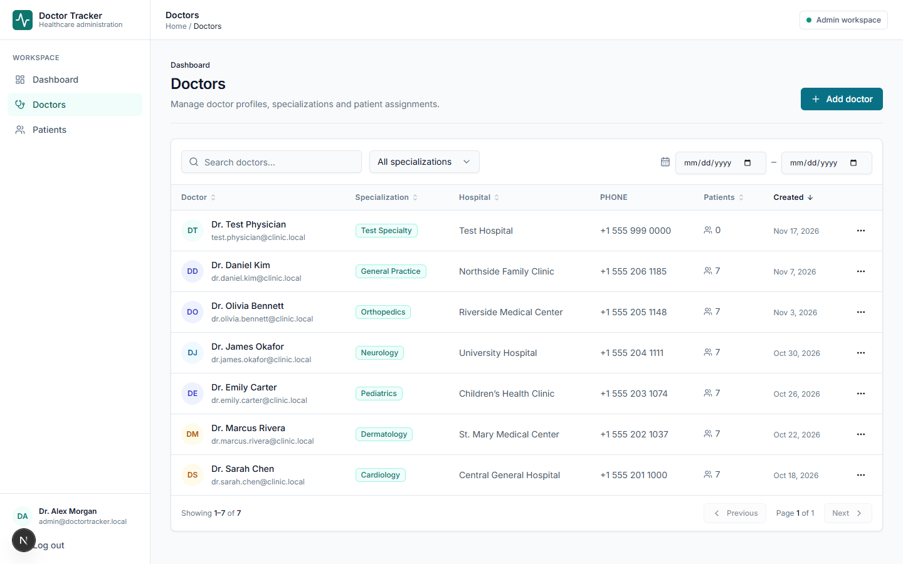
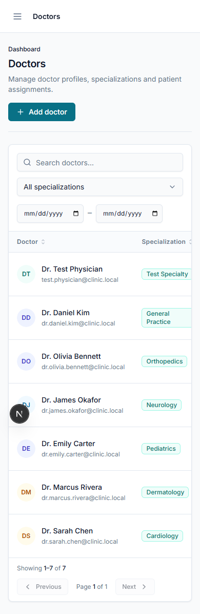
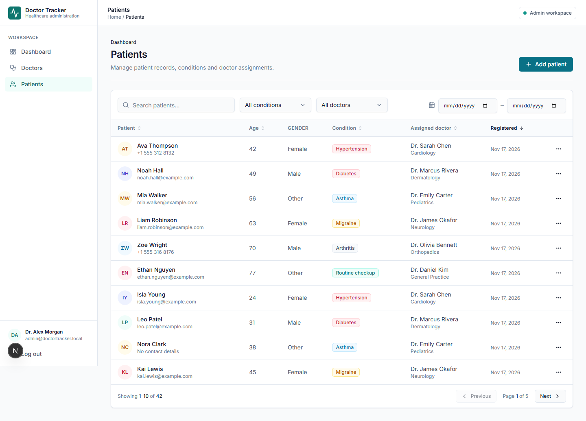
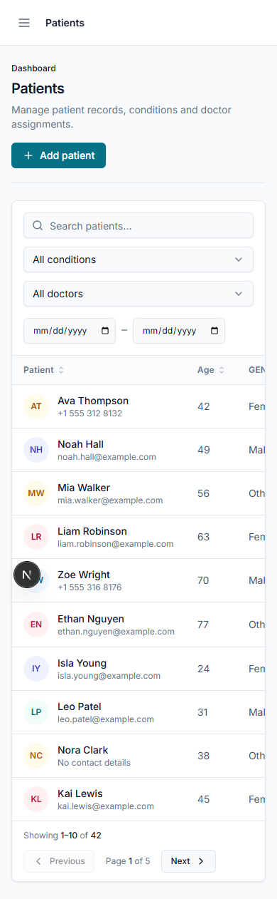

# Doctor Tracker Frontend

> Premium, responsive admin workspace for managing doctors, patients and clinic analytics. Talks to the standalone [Doctor Tracker API](../doctor-tracker-backend/README.md) over REST.

## 1. What this is

A Next.js App Router application implementing the full Doctor Tracker admin experience. It contains **no** API routes — every metric and mutation comes from the backend via `NEXT_PUBLIC_API_URL`.

## 2. Features

- Professional split-screen login with validation, password visibility toggle and error/loading states.
- Persistent desktop sidebar, top bar with breadcrumbs and admin profile, responsive mobile drawer.
- Dashboard with 4 KPI cards, 4 real aggregation-backed charts, date-range selection, recent patients and top doctors.
- Doctors: searchable/filterable/sortable table, create/edit/delete, details page with contact info and associated patients, direct "add patient" action, relationship-safe delete confirmation.
- Patients: searchable/filterable/sortable table, create/edit/delete, doctor selector, condition badges, graceful handling of missing contact details.
- Shareable URL state (search, filters, pagination, sorting), debounced search, server-side pagination.
- Polished loading, empty, error and success (toast) states throughout.

## 3. Tech stack

Next.js 15 (App Router) · React 19 · TypeScript strict · Tailwind CSS 3 · shadcn/ui-style primitives on Radix UI · Lucide icons · TanStack Query 5 · React Hook Form + Zod · Recharts · Sonner · Vitest + Testing Library · Playwright (screenshots).

## 4. Architecture

```
Browser
  ├── AuthProvider (calls /auth/me on mount → guarded routes)
  ├── QueryProvider (caching, invalidation, retry policy)
  └── AppShell (sidebar / topbar / mobile drawer)
        ├── /login
        ├── /dashboard      → dashboardApi  ┐
        ├── /doctors        → doctorsApi    ├─ centralized api client (credentials: include)
        ├── /doctors/[id]   → doctorsApi+patientsApi
        └── /patients       → patientsApi   ┘
                                  │
                                  ▼
                     Backend REST API (separate repo)
```

**Data flow:** a page reads list parameters from the URL via `useListParams`, debounces the search term, and passes them to a TanStack Query hook (`useDoctors`, `usePatients`, …). The query hits `lib/api/client.ts`, which sends cookies, unwraps `data`, and throws typed `ApiClientError`s. Mutations invalidate the doctors, patients and dashboard query keys so all views refresh consistently.

## 5. Folder structure

```
src/
├── app/
│   ├── (dashboard)/         protected routes: dashboard, doctors, patients
│   ├── login/               sign-in page
│   ├── globals.css          design tokens (HSL CSS variables)
│   └── layout.tsx           providers
├── components/
│   ├── ui/                  shadcn-style primitives (button, dialog, select, table…)
│   ├── common/              PageHeader, DataTable, Pagination, states, filters, dialogs
│   ├── layout/              AppShell, Sidebar, nav items
│   ├── dashboard/           dynamically imported Recharts components
│   ├── doctors/             DoctorForm
│   └── patients/            PatientForm
├── lib/
│   ├── api/                 centralized client + endpoint modules
│   ├── hooks/               TanStack Query hooks, debounce, URL list params
│   ├── types.ts             shared domain types
│   ├── validators.ts        client-side Zod schemas
│   └── utils.ts             formatting, initials, tones, query strings
└── tests/                   Vitest + Testing Library suites
screenshots/                 real Playwright captures (desktop + mobile)
scripts/capture-screenshots.mjs
```

## 6. Local setup

```bash
cd doctor-tracker-frontend
npm install
cp .env.example .env.local
# set NEXT_PUBLIC_API_URL to your backend (/api/v1)
npm run dev       # http://localhost:3000
```

The backend must be running and reachable, and `CORS_ORIGINS` on the backend must include the frontend origin. Login with the seeded admin.

### Environment variables

| Variable | Required | Example |
| --- | --- | --- |
| `NEXT_PUBLIC_API_URL` | yes | `http://localhost:4000/api/v1` (local) · `https://your-api.onrender.com/api/v1` (production) |

No secrets live in the frontend. Authentication is cookie-based with `credentials: 'include'`.

## 7. Design system

Design tokens are HSL CSS variables in `globals.css`: white/neutral surfaces, charcoal-navy foreground, restrained teal accent (`--primary`), subtle borders and a single small shadow. Cards use modest radii (6–8px). Charts share fixed colors/tooltip styling. Condition badges are restrained pastel tones. No gradients or glassmorphism.

## 8. Testing

```bash
npm test              # 20 component/unit tests
npm run typecheck
npm run build
npm run lint          # Next.js ESLint (interactive first-run setup)
```

Tests cover login validation and submission, form validation and CRUD submission, table rendering, pagination controls, empty/error/loading states, validators and formatting utilities.

### Screenshots

Real captures from the running application (seeded demo data, no mockups):

| Desktop | Mobile |
| --- | --- |
|  |  |
|  |  |
|  |  |

Regenerate them with:

```bash
# with backend demo server + frontend dev server running
node scripts/capture-screenshots.mjs
```

The script uses a locally installed Chrome (`CHROME_PATH` overrides the default path).

## 9. Deployment (Vercel)

1. Import this folder as a Vercel project (framework preset: Next.js). `vercel.json` is included.
2. Add environment variable `NEXT_PUBLIC_API_URL=https://your-api.onrender.com/api/v1`.
3. Deploy. On the backend, set `CORS_ORIGINS` to the Vercel domain and `COOKIE_SAME_SITE=none`, `COOKIE_SECURE=true` so cross-origin cookies work over HTTPS.
4. Build command: `npm run build` (Vercel default). Output: Next.js standard.

## 10. Key technical decisions

1. **Client-side auth guard with server-enforced protection.** `AuthProvider` calls `/auth/me` on mount and the `AppShell` redirects unauthenticated users to `/login`, giving a clean UX across reloads. The real security boundary is the backend, which rejects every API request without a valid cookie — UI state alone is never trusted.
2. **URL as the source of truth for list state.** Search/filter/sort/page live in `useSearchParams`, so views are shareable and browser back/forward works. Search input is local and debounced before being written to the URL, avoiding a request per keystroke.
3. **Dynamic chart imports.** Recharts is loaded via `next/dynamic` with skeleton placeholders, keeping initial page JS smaller.

## 11. Performance

- Server-side pagination/filtering; no client-side slicing of collections.
- 30s stale time, window-focus refetch disabled, bounded retries for 4xx errors.
- Mutations invalidate only relevant query key prefixes.
- `useDebounce` prevents redundant network calls while typing.
- Charts are dynamically imported and wrapped in responsive containers.

## 12. Known limitations

- The admin session ends when the JWT expires (default 7 days); there is no silent refresh-token rotation.
- The mobile table scrolls horizontally rather than reflowing into cards (clear column labels are retained).
- Recharts v2 is pinned for stability; migrating to v3 is possible but not required.
